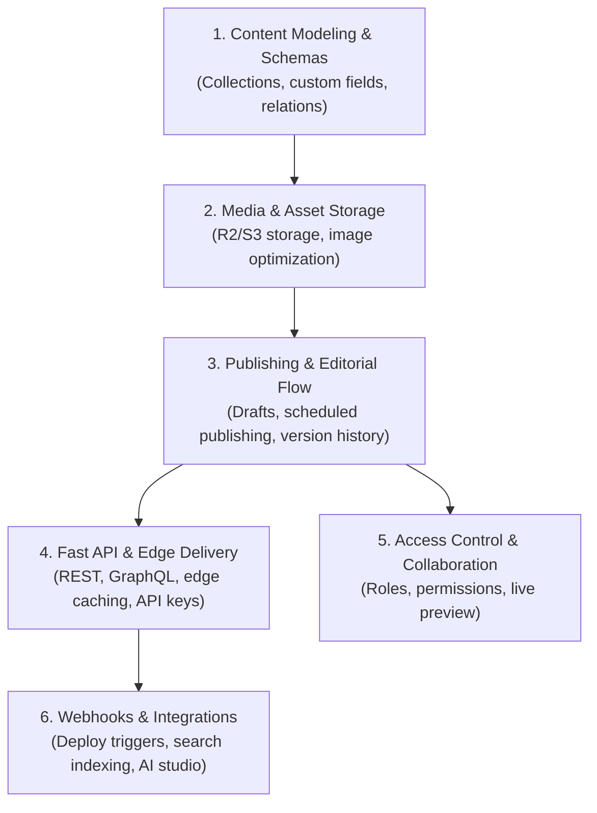
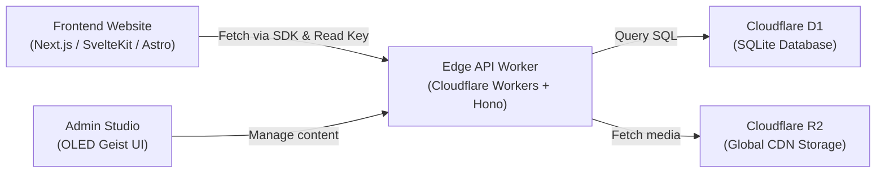

# CMS Features: Simple & Clear Guide

> A concise, beginner-friendly breakdown of standard CMS (Content Management System) features, content workflows, and how they connect with **CFEdge-CMS**.

---

## 1. What is a CMS in Simple Terms?

A **CMS (Content Management System)** allows teams to create, edit, organize, and publish digital content (articles, products, pages, media) without needing to write code every time.

### Traditional CMS vs. Modern Headless CMS

* **Traditional CMS (e.g., WordPress, Drupal):**  
  Ties the database, content editor, and website frontend together into one monolithic system. Changing the design requires modifying template themes.
* **Modern Headless CMS (e.g., EdgeCMS, Strapi, Sanity, Payload):**  
  Separates the content management backend ("the body") from the frontend display ("the head"). Content is delivered via fast **APIs** (REST / GraphQL) to power any website (Next.js, SvelteKit, Astro), mobile app, or smart screen.

---

## 2. The 4 Basic Steps of CMS Content Flow

```text
1. Author creates / edits content in Admin Studio
              |
              v
2. Editorial Review & Live Frontend Preview
              |
              v
3. Publish to Database (Draft ➔ Published)
              |
              v
4. Frontend renders content via Edge API (Next.js, SvelteKit, Mobile)
```

### The 5 Core Building Blocks

| Entity | What It Means | Real Example |
| :--- | :--- | :--- |
| **Collection** | A content blueprint or table with defined schema. | `posts`, `products`, `authors`, `pages`. |
| **Field** | An individual attribute inside a collection. | `title` (text), `content` (markdown), `price` (number). |
| **Entry / Record** | One single published or drafted item in a collection. | "How to Deploy to Cloudflare" blog post. |
| **Media Asset** | Files uploaded to object storage (CDN). | `banner.webp`, `logo.svg`, `whitepaper.pdf`. |
| **API Endpoint** | The URL where frontends fetch content. | `GET https://api.edgecms.dev/api/content/posts`. |

---

## 3. The 6 Core Modules of a Standard CMS



---

### 🔹 Module 1: Content Modeling & Schema Architecture
* **Custom Collections:** Define dynamic data structures (e.g., Blog Posts, Team Members, FAQs, Case Studies).
* **Flexible Field Types:**
  * Basic: Text, Textarea, Number, Boolean, Select Dropdown, Date/Time.
  * Rich: Markdown, WYSIWYG / Block-based editor, Color Picker.
  * Relational: Link an Author to a Post, or Category tags to a Product.
* **Code-First or Visual Builder:** Define models via code (`cms.config.ts`) or create them visually in the admin panel.

---

### 🔹 Module 2: Media & Asset Management
* **Object Storage (R2 / S3):** Upload and host images, videos, and documents on global CDN storage.
* **On-the-Fly Optimization:** Automatic conversion to modern WebP/AVIF formats and responsive resizing.
* **Metadata & Accessibility:** Manage Alt-text, captions, dimensions, and file sizes.
* **Media Folder Organization:** Categorize files by tags, folders, or collections.

---

### 🔹 Module 3: Editorial Workflow & Publishing Controls
* **Draft vs. Published:** Edit content safely behind closed doors without affecting the live website.
* **Live Visual Preview:** See how the draft looks on the real frontend before clicking publish.
* **Scheduled Publishing:** Schedule an announcement or product drop to go live at a specific date and time.
* **Version History & Rollbacks:** View previous revisions and restore an earlier version with 1 click.

---

### 🔹 Module 4: API, Edge Delivery & Performance
* **Headless REST / GraphQL APIs:** Simple endpoints for frontends (`/api/content/:collection`).
* **Sub-50ms Global Edge Caching:** Cache content across global CDN points of presence (Cloudflare Workers).
* **API Key Security:** Public Read Keys for web apps and secure Admin tokens for write actions.
* **TypeScript Type Generation:** Auto-generate TypeScript definitions from schemas for 100% type-safe frontends.

---

### 🔹 Module 5: User Roles & Collaboration
* **Role-Based Access Control (RBAC):**
  * *Super Admin:* Full system and database settings access.
  * *Editor:* Can review, edit, and publish any entry.
  * *Author / Contributor:* Can draft new articles but cannot publish directly.
* **Audit Logs:** Immutable record of who edited, published, or deleted content.
* **Multi-User Lock / Presence:** Prevent two editors from accidentally overwriting each other's work.

---

### 🔹 Module 6: Webhooks & Integrations
* **Rebuild Webhooks:** Trigger automatic static site rebuilds on Vercel, Cloudflare Pages, or Netlify when content is published.
* **Search Indexing:** Automatically push updated articles to search engines like Algolia, MeiliSearch, or Typesense.
* **Internationalization (i18n):** Publish content in multiple languages (e.g., `/en/`, `/es/`, `/ja/`) with localized fields.

---

## 4. Quick Feature Checklist: Must-Have vs. Advanced

| Category | Must-Have (Starter / MVP) | Standard (Growing Team) | Advanced (Enterprise / Edge) |
| :--- | :--- | :--- | :--- |
| **Content** | Custom collections, text, dates | Relational fields, block editor | Code-first auto-sync (`cms.config.ts`) |
| **Media** | File upload, image display | Folder organization, alt tags | On-the-fly edge resizing (WebP/AVIF) |
| **Publishing** | Publish/Delete buttons | Draft state, scheduled publishing | Live split-screen preview, rollback history |
| **APIs** | Simple REST GET endpoints | Public read keys, rate limiting | Edge-native sub-50ms global caching |
| **Security** | Single admin password | Multi-user roles (Admin, Editor) | Granular field-level RBAC & audit logs |
| **Ecosystem** | Basic JSON output | Outbound webhooks (Vercel/Netlify) | AI Prompt Studio & TypeScript SDK generation |

---

## 5. Next-Gen Modern CMS Trends (2025–2026)

Modern headless systems (like **Sanity**, **Payload CMS**, and **EdgeCMS**) lead with developer productivity and AI:

1. **Edge-Native Infrastructure:** Instead of bulky Node.js or Docker servers, running serverless on **Cloudflare Workers + D1** provides global distribution with zero cold starts.
2. **AI-Assisted Content Authoring:** Built-in AI tools to generate SEO meta tags, proofread copy, translate text, and auto-generate alt text for media.
3. **AI Agent Prompt Studio:** 1-click generation of TypeScript types, endpoints, and frontend integration prompts for AI coding agents (Cursor, Windsurf, Claude Code).
4. **Code-First Schemas:** Versioning content schemas in Git (`cms.config.ts`) alongside frontend code rather than clicking through slow web dashboards.

---

## 6. How CFEdge-CMS Implements These Capabilities

**CFEdge-CMS** is engineered around lightweight, modern edge-native standards:



### High-Impact Features for EdgeCMS Roadmap:

1. **Draft vs. Published Workflow:**  
   Add a `status` field (`draft` | `published`) so editors can preview staging content before pushing live.
2. **Deploy Trigger Webhooks:**  
   Add an outbound webhook setting in Admin Studio to ping Vercel / Cloudflare Pages to rebuild static pages on publish.
3. **Scheduled Publishing:**  
   Use Cloudflare Cron Triggers to automatically flip scheduled drafts to published status at a specified date and time.
4. **Multi-Language (i18n):**  
   Add locale support (`en`, `es`, `fr`) to collection schemas so content can be fetched by locale: `/api/content/:slug?locale=fr`.
