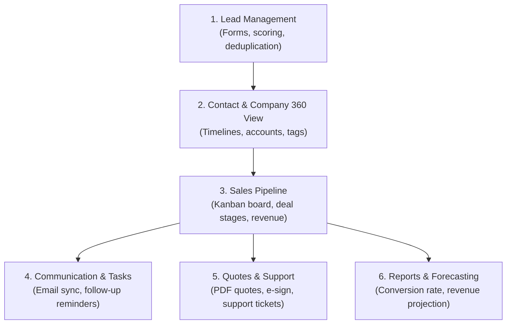
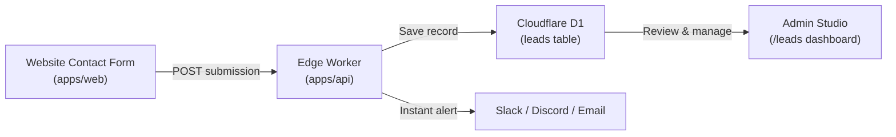

# CRM Features: Simple & Clear Guide

> A concise, beginner-friendly breakdown of standard CRM (Customer Relationship Management) features, data flow, and how they connect with a CMS like **EdgeCMS**.

---

## 1. What is a CRM in Simple Terms?

A **CRM (Customer Relationship Management)** system helps a business organize and track everyone it interacts with — from a stranger visiting the website to a long-time paying customer.

Instead of keeping messy spreadsheets or scattered emails, a CRM provides a single home to answer three core questions:
1. **Who are our leads and customers?** *(Contacts & Companies)*
2. **Where is each potential sale right now?** *(Pipelines & Deals)*
3. **What is the next step to close or support them?** *(Tasks, Meetings & Notes)*

---

## 2. The 4 Basic Steps of CRM Data Flow

```text
1. Website Visitor / Form Fill
              |
              v
2. Lead (Unqualified person showing interest)
              |
              v (When vetted / qualified)
3. Contact (Person)  +  Company (Account)
              |
              v
4. Deal (Sales Pipeline)  -->  Closed Won / Closed Lost
```

### The 5 Core Building Blocks

| Entity | What It Means | Real Example |
| :--- | :--- | :--- |
| **Lead** | An unverified person who showed interest. | Someone filled a "Book a Demo" form. |
| **Contact** | A verified individual you communicate with. | John Doe (`john@acme.com`), VP of Marketing. |
| **Account (Company)** | The business or organization a contact belongs to. | Acme Corp (`acme.com`, 50 employees). |
| **Deal (Opportunity)** | An active sales conversation with a dollar value. | "$10,000 Annual Contract" in the *Proposal* stage. |
| **Activity** | Any recorded touchpoint or event. | Email sent, phone call logged, meeting booked, note added. |

---

## 3. The 6 Core Modules of a Standard CRM



---

### 🔹 Module 1: Lead Management & Ingestion
* **Web Form Capture:** Connects website contact forms directly into the CRM database.
* **Spam & Bot Filtering:** Protects forms with verification (like Cloudflare Turnstile).
* **Deduplication:** Prevents duplicate entries when the same person submits twice.
* **Lead Scoring:** Adds points for high-intent actions (e.g., +20 for viewing the pricing page, +15 for booking a call).
* **1-Click Conversion:** Instantly turns a qualified Lead into a Contact, Company, and Deal with zero retyping.

---

### 🔹 Module 2: Contact & Company (360° Profile)
* **Chronological Timeline:** One single feed showing every email, note, call, and form submission for that person.
* **Company Hierarchy:** Groups multiple colleagues under one company (e.g., CEO, Tech Lead, Billing).
* **Custom Tags & Lists:** Filter contacts easily (e.g., *"All VIP Leads"*, *"Inactive for > 30 days"*).
* **Auto-Enrichment:** Automatically fetches company logos, headcounts, and LinkedIn links from company email domains.

---

### 🔹 Module 3: Sales Pipeline & Deal Tracking
* **Visual Kanban Board:** Drag-and-drop cards between stages:  
  `New Lead` ➔ `Demo Done` ➔ `Proposal Sent` ➔ `Negotiating` ➔ `Closed Won` / `Closed Lost`
* **Multiple Pipelines:** Separate boards for different sales processes (e.g., *Self-Serve SaaS* vs. *Enterprise Sales*).
* **Deal Amount & Target Date:** Track expected revenue and target closing month.
* **Win/Loss Tracking:** Captures why a deal was won or lost (e.g., *"Competitor price"*, *"Missing feature"*).

---

### 🔹 Module 4: Communication & Tasks
* **2-Way Email Sync:** Syncs with Gmail / Outlook. Sent and received emails automatically appear on the contact's record.
* **Email Open & Click Tracking:** Get notified the second a prospect opens your proposal.
* **Task Reminders & Cadences:** Schedule follow-ups (e.g., *"Call client in 3 days"*).
* **Meeting Scheduler Link:** Shareable booking link (like Calendly) that syncs with Google/Outlook calendars.
* **Internal Team Notes:** Leave private notes and `@mention` teammates directly on a deal.

---

### 🔹 Module 5: Quotes, Invoicing & Support
* **Product Catalog:** Pre-saved list of products, subscription tiers, and unit prices.
* **1-Click PDF Proposals:** Automatically generates branded quotes with itemized totals and discount rules.
* **E-Signature:** Let clients sign contracts digitally on their phone or laptop.
* **Customer Support Tickets:** Receive customer issues by email/web form and track response time (SLA).

---

### 🔹 Module 6: Reports & Revenue Forecasting
* **Revenue Forecast:** Predicts incoming revenue based on deal probability:  
  `Forecasted Revenue = Deal Value × Stage Win Probability %`
* **Conversion Funnel:** Shows where leads drop off between initial visit and closed sale.
* **Rep Leaderboard:** Tracks calls made, emails sent, and deals closed per team member.

---

## 4. Quick Feature Checklist: Must-Have vs. Advanced

| Category | Must-Have (Starter / MVP) | Standard (Growing Team) | Advanced (Enterprise / AI) |
| :--- | :--- | :--- | :--- |
| **Leads** | Inbound form capture, table view | Duplicate checking, manual scoring | Autonomous AI lead qualification |
| **Contacts** | Name, email, phone, notes | 360° timeline, company linking | Automatic data enrichment (Apollo/Clearbit) |
| **Pipelines** | Drag-and-drop Kanban, deal amount | Multiple pipelines, win/loss reasons | Weighted AI revenue forecasting |
| **Communication** | Manual call & note logging | 2-way Gmail/Outlook sync, open alerts | VoIP click-to-call, AI call transcriptions |
| **Automation** | New lead email/Slack notification | Drip email sequences, automated tasks | Custom visual multi-step workflow engine |
| **Security** | Single admin password | Multi-user roles (Sales Rep, Admin) | Granular record-level permissions & audit logs |

---

## 5. Next-Gen Modern CRM Trends (2025–2026)

Modern platforms (like **Twenty CRM**, **Attio**, **HubSpot**) have eliminated traditional manual data entry:

1. **Zero Data Entry:** The CRM monitors calendar invites and emails in the background and automatically creates contacts and activity entries without manual input.
2. **Conversation Intelligence:** AI transcribes sales calls, highlights customer objections, and drafts follow-up emails instantly.
3. **Code-First Custom Data:** Developers can declare custom data models and relationships directly in TypeScript/code rather than through clunky administrative UI menus.

---

## 6. How to Add CRM Features to EdgeCMS

Because **EdgeCMS** already runs on Cloudflare Workers, D1 SQL, and SvelteKit, adding lightweight CRM capabilities is clean and fast:



### 3 High-Value Features EdgeCMS Can Implement:

1. **Inbound Form API (`POST /api/leads`):**  
   Accepts submissions from website forms, verifies bots with Cloudflare Turnstile, and saves records into a D1 SQL `leads` table.
2. **Admin Studio Leads Dashboard (`/leads`):**  
   A clean OLED table view to view incoming inquiries, tag status (`New`, `Contacted`, `Qualified`, `Closed`), and export to CSV.
3. **Instant Notification Webhooks:**  
   Automatically dispatch a notification to a Slack channel or team email whenever a high-priority lead submits a form.
